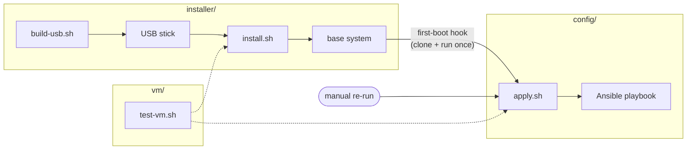

# llangvilla

Configuration for the home network. Currently one machine: a Dell OptiPlex desktop (`optiplex`) running Arch Linux with KDE Plasma.

## Overview

The repository has three independent parts:

| Part | Directory | Purpose | Runs |
|---|---|---|---|
| Installer | [`installer/`](installer/README.md) | Ventoy USB stick that wipes the machine and installs a clean base system | On a reinstall |
| Config | [`config/`](config/README.md) | Personalises the installed system: apps, theming, settings (Ansible; Nix home-manager planned) | On first boot, then whenever the config changes |
| VM | [`vm/`](vm/README.md) | Runs the installer and the config from the working tree in a QEMU VM | Before changes reach the real machine |



## Quick start

Reinstall the machine from scratch:

```bash
eval "$(installer/build-usb.sh /dev/sdX)"                   # build the stick
nano "$V/arch-autoinstall/autoinstall.env"                  # fill in Wi-Fi and password hash
installer/install.sh --check "$V/arch-autoinstall/autoinstall.env"
# boot the machine from the stick; it installs and powers off
```

Apply a config change to the running machine:

```bash
sudo /opt/llangvilla/config/apply.sh
```

Try a change in a VM first:

```bash
vm/test-vm.sh            # full install + config from the working tree
vm/test-vm.sh config     # re-apply config/ to an existing test install
vm/test-vm.sh boot       # open the VM in a window
```

## Repository layout

```
.
├── installer/             Installer: ISO build, USB stick, install.sh, base package list
├── config/                Config: apply.sh entrypoint and the Ansible playbook
│   └── ansible/
├── vm/                    VM test harness
├── .github/workflows/     CI: lint (every push) and VM test (manual)
└── TODO.md
```

## How the parts connect

The installer and the config share one interface, the **first-boot hook**:

1. The installer writes a systemd unit, `llangvilla-firstboot.service`, into the new system.
2. On first boot the unit clones this repository to `/opt/llangvilla` and runs `config/apply.sh` once, before the login screen starts.
3. After that the installer is out of the picture. The checkout stays at `/opt/llangvilla`, and `apply.sh` is re-run by hand.

Rules that keep the parts independent:

- The installer knows the repository URL and the entrypoint path, nothing about Ansible.
- The config relies on the base system from `installer/packages.txt`, not on installer settings. Values such as the user name live in the config's own variables.
- A package goes in the base only if the machine needs it to boot to a usable desktop. Everything else goes in the config. See [`config/README.md`](config/README.md#what-goes-in-the-config).

## Development

| Check | Command | CI |
|---|---|---|
| Shell scripts | `shellcheck installer/*.sh config/*.sh vm/*.sh` | `lint.yml`, every push |
| Env template | `installer/install.sh --check FILE` | `lint.yml` |
| YAML | `yamllint .` | `lint.yml` |
| Ansible | `ansible-lint config/ansible` | `lint.yml` |
| End to end | `vm/test-vm.sh all` | `vm-test.yml`, manual (Actions tab) |

Install the linters with `pip install shellcheck-py ansible ansible-lint yamllint`.

Never commit real Wi-Fi credentials, password hashes or a filled-in `autoinstall.env`. They live only on the USB stick (see [Security](installer/README.md#security)).
